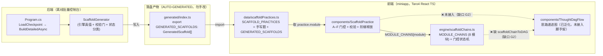

# ScaffoldGenerator → 前端脚手架 → 思路递进图：整体设计

> 生成时间：2026-11-25
> 范围：把「后端 ScaffoldGenerator 批量生成脚手架产物」到「前端 A–F 精熟练习消费」到「ThoughtDagFlow 思路递进图展示」整条链路的设计补全到接口级，并标出缺口与补齐契约。
> 方法：逐文件读码核实（非臆测），所有结论附源码 `file:///` 链接；接口/字段/类型均来自真实代码。
> 关联：上一轮已完成 ScaffoldGenerator 审查修复（commit `96b4d2c`）；本设计承接其后续。

---

## 0. 执行摘要

CogniThink-Chem 的「脚手架练习」能力已形成一条真实端到端链路，但存在**三个量级的缺口**：

1. **覆盖缺口（最大）**：后端 ScaffoldGenerator 目前只生成了 **4 道题，全部 `redox-reasoning`**（见 [generated/index.ts](file:///D:/github/CogniThink-Chem/miniapp/src/data/scaffolds/generated/index.ts)）；而前端 [ScaffoldModuleKind](file:///D:/github/CogniThink-Chem/miniapp/src/types/scaffold.ts#L49-L57) 已定义 **8 个模块**，[MODULE_CHAINS](file:///D:/github/CogniThink-Chem/miniapp/src/engine/scaffoldChains.ts#L72) 已就绪全部 8 条 A–F 链。其余 7 个模块目前只有 [scaffoldPractices.ts](file:///D:/github/CogniThink-Chem/miniapp/src/data/scaffoldPractices.ts) 里的少量手写题。
2. **展示缺口**：[ThoughtDagFlow](file:///D:/github/CogniThink-Chem/miniapp/src/components/ThoughtDagFlow/index.tsx) 组件已泛化（支持 `dag?` 直传 + 单列自适应布局），但**未接入**脚手架练习页（`ScaffoldPractice`）与反应详情页（`pages/reaction`）；转换层 `scaffoldChainToDAG` 尚不存在，[ThoughtChainScope](file:///D:/github/CogniThink-Chem/miniapp/src/types/thoughtChain.ts#L70-L72) 联合缺 `scaffold`/`reaction` 变体。
3. **契约对齐缺口（小）**：后端 `ScaffoldValidationSummary` 有内部 `Conflict` 分类字段（标 `[JsonIgnore]` 不序列化），前端类型无此字段——当前兼容，但设计上应显式记录，避免后续误加。

**结论**：链路骨架与契约已对齐良好，主要工作是「后端推广到 8 模块」（P1，大工程，需逐模块 spec）和「前端补完 DAG 展示接入」（P0，纯前端低风险）。本设计给出 P0 的精确接口契约，并为 P1 列出推广路线与每模块的引擎真值来源评估。

---

## 1. 端到端数据流（现状）



**关键事实**：
- 后端生成入口是离线控制台 [Program.cs](file:///D:/github/CogniThink-Chem/src/CogniThink.TutorBrain.ScaffoldGenerator/Program.cs)，不在线热路径；产物是静态 TS 文件，前端直接 import，无运行时 API 调用。
- 前端 [ScaffoldPractice 组件](file:///D:/github/CogniThink-Chem/miniapp/src/components/ScaffoldPractice/index.tsx#L21) 消费的是 `SCAFFOLD_PRACTICES`（手写 + 生成拼接），用 `practice.module` 反查 `MODULE_CHAINS` 拿 A–F 链，**不直接依赖后端在线服务**——纯前端可跑通。

---

## 2. 各层契约（接口级，字段表）

### 2.1 后端产物契约：`GeneratedScaffold`

后端定义见 [ScaffoldGeneratorContracts.cs](file:///D:/github/CogniThink-Chem/src/CogniThink.TutorBrain.Api/Application/ScaffoldGenerator/ScaffoldGeneratorContracts.cs)；前端镜像类型见 [types/scaffold.ts#L254-L263](file:///D:/github/CogniThink-Chem/miniapp/src/types/scaffold.ts#L254-L263)。`GeneratedScaffold extends ScaffoldPractice`，是练习题的超集，带可追溯审计字段。

| 字段 | 类型 | 必填 | 序列化 | 来源 / 说明 |
|------|------|------|--------|-------------|
| `id` | `string` | 是 | 是 | 生成题 id，如 `gen_pdf-104` |
| `title` | `string` | 是 | 是 | 练习标题 |
| `module` | `ScaffoldModuleKind` | 是 | 是 | 取哪条 A–F 链；枚举序列化为连字符小写（如 `redox-reasoning`），由 `[JsonConverter(EnumMemberJsonConverter<>)]` 保证 |
| `conditions` | `BranchConditions?` | 否 | 空则省略 | 分支判定依据 |
| `branchEntryId` | `string?` | 否 | 空则省略 | 关联分支真值条目 |
| `steps` | `StepPractice[]` | 是 | 是 | 与链 A–F 一一对应；降级步 `truth=null` |
| `sourceQuestionId` | `string` | 是 | 是 | 来源 eval case id（审计） |
| `provenance` | `Record<string,string>` | 是 | 是 | 每步 correct 来源引擎字段，键为 kind 字符串（如 `"F": "RedoxAnalysis.Changes"`） |
| `degradedSteps` | `DegradedStep[]` | 是 | 是 | 降级为只读揭示的步及原因 |
| `validation` | `ScaffoldValidationSummary` | 是 | 是 | 发布前校验门结果 `{ ok, errors }` |
| `validation.conflict` | `bool` | 是 | **否（`[JsonIgnore]`）** | 后端内部「F correct 与 answer 真实冲突」分类，仅驱动 `status=conflict`，不进产物 → 前端类型无此字段，兼容 |

**`StepPractice` / `StepGroundTruth` 契约**（[scaffold.ts#L210-L217](file:///D:/github/CogniThink-Chem/miniapp/src/types/scaffold.ts#L210-L217)、[#L143-L146](file:///D:/github/CogniThink-Chem/miniapp/src/types/scaffold.ts#L143-L146)）：

| 字段 | 形态 | 说明 |
|------|------|------|
| `truth` | `null` 或 `{ type, options, correct }` | `null` = 引擎无法可靠产出 correct → 前端渲染只读揭示、不渲染作答控件 |
| `truth.type` | `'multi-check'` \| `'single-select'` \| `'order'` | 与 `AtomicTask.interaction` 一一对应 |
| `releases` | `{ hint, probe, scaffold, reveal }` | 阶梯释放三档，全部必填（任意错误次数都有内容，永不崩） |

### 2.2 前端链与门控契约

| 符号 | 位置 | 契约 |
|------|------|------|
| `ScaffoldModuleKind` | [scaffold.ts#L49-L57](file:///D:/github/CogniThink-Chem/miniapp/src/types/scaffold.ts#L49-L57) | 8 模块联合：`redox-reasoning` / `ionic-system` / `aqueous-equilibrium` / `sequential-reaction` / `electrochem-reasoning` / `chemical-equilibrium` / `inorganic-inference` / `organic-reaction` |
| `ScaffoldChain` | [scaffold.ts#L60-L67](file:///D:/github/CogniThink-Chem/miniapp/src/types/scaffold.ts#L60-L67) | `{ module: ScaffoldModuleKind \| 'reaction'; name; tasks: AtomicTask[] }` |
| `AtomicTask` | [scaffold.ts#L17-L32](file:///D:/github/CogniThink-Chem/miniapp/src/types/scaffold.ts#L17-L32) | `{ index, kind, title, goal, interaction, checks, pitfall? }` |
| `MODULE_CHAINS` | [scaffoldChains.ts#L72](file:///D:/github/CogniThink-Chem/miniapp/src/engine/scaffoldChains.ts#L72) | `Record<ScaffoldModuleKind, ScaffoldChain>`，8 条链全量定义 |
| `REACTION_SCAFFOLD_CHAIN` | [scaffoldChains.ts#L187](file:///D:/github/CogniThink-Chem/miniapp/src/engine/scaffoldChains.ts#L187) | 反应侧 A–E 子集（`module: 'reaction'`，F 省略） |
| `StepGateState` | [scaffold.ts#L41](file:///D:/github/CogniThink-Chem/miniapp/src/types/scaffold.ts#L41) | `'locked' \| 'unlocked' \| 'passed' \| 'failed'` |
| 门控纯函数 | [scaffoldChains.ts#L208-L268](file:///D:/github/CogniThink-Chem/miniapp/src/engine/scaffoldChains.ts#L208-L268) | `initialGateStates(n)` / `markPassed` / `markFailed` / `resetStep` / `resolveStep`，全部纯函数、不就地修改、越界返回安全空值不抛错 |

### 2.3 DAG 展示契约（ThoughtChainDAG）

| 符号 | 位置 | 契约 |
|------|------|------|
| `ThoughtChainNode` | [thoughtChain.ts#L38-L67](file:///D:/github/CogniThink-Chem/miniapp/src/types/thoughtChain.ts#L38-L67) | 超集：`id/index/title/goal` 必填；`analyze?/layer?/stage?/skipWhen?/branchKey?/metaPhase?/interaction?/checks?/pitfall?` 可选（`analyze`/`layer` 已改可选，脚手架节点无来源可诚实省略） |
| `ThoughtChainScope` | [thoughtChain.ts#L70-L72](file:///D:/github/CogniThink-Chem/miniapp/src/types/thoughtChain.ts#L70-L72) | **当前仅** `{ kind:'category'; category } \| { kind:'meta' }`；**缺 `scaffold`/`reaction` 变体（缺口 G2）** |
| `ThoughtChainDAG` | [thoughtChain.ts#L75-L82](file:///D:/github/CogniThink-Chem/miniapp/src/types/thoughtChain.ts#L75-L82) | `{ scope; name; nodes: ThoughtChainNode[] }` |
| `ThoughtDagFlow` Props | [ThoughtDagFlow/index.tsx#L15-L26](file:///D:/github/CogniThink-Chem/miniapp/src/components/ThoughtDagFlow/index.tsx#L15-L26) | `{ challenge?, dag?, mode?:'preview'\|'full', dimmedIds?: Set<string>, legendLabels? }`；取数优先级 `dag > challenge`；布局自适应：有 `metaPhase` → 横向分层，无 → 单列垂直 |

---

## 3. 现状缺口清单（量化 + 可追溯）

| 编号 | 缺口 | 量化证据 | 影响 |
|------|------|----------|------|
| **G1** | 后端模块覆盖严重不足 | `generated/index.ts` 仅 4 个 `module` 字段，**全为 `redox-reasoning`**（[L9/L341/L655/L987](file:///D:/github/CogniThink-Chem/miniapp/src/data/scaffolds/generated/index.ts)）；前端有 8 模块链 | 7/8 模块无后端生成题，脚手架练习题库薄 |
| **G2** | DAG 展示未接入脚手架/反应 | grep `scaffoldChainToDAG` 无匹配；`ThoughtChainScope` 无 `scaffold`/`reaction`；`ThoughtDagFlow` 仅被 `challenge/index.tsx` 引用（grep） | 脚手架练习与反应详情页无思路递进图 |
| **G3** | 组件选型表述冲突 | [ScaffoldPractice/index.tsx#L213](file:///D:/github/CogniThink-Chem/miniapp/src/components/ScaffoldPractice/index.tsx#L213) 注释：StepProgress「替代大块思路递进图」；plan2 又要接入 ThoughtDagFlow | 需裁决两者关系（见 §4.3，结论：可并存，职责不同） |
| **G4** | 反应侧链已定义但未用图 | `REACTION_SCAFFOLD_CHAIN` 已存在；[pages/reaction/index.tsx](file:///D:/github/CogniThink-Chem/miniapp/src/pages/reaction/index.tsx) 无思路图（plan2 调研结论） | 反应详情页缺推导路径可视化 |
| **G5** | 校验摘要字段不对齐（兼容） | 后端 `ScaffoldValidationSummary.Conflict` 标 `[JsonIgnore]`；前端类型无 `Conflict` | 当前兼容不崩，但设计上应显式记录（见 §2.1 已记录） |

---

## 4. 接口级补齐设计（针对缺口）

### 4.1 扩展 `ThoughtChainScope`（修 G2 前置）

**文件**：[miniapp/src/types/thoughtChain.ts](file:///D:/github/CogniThink-Chem/miniapp/src/types/thoughtChain.ts#L69-L72)

```ts
/** 推导图作用域：题型视角 / 跨题型元骨架 / 脚手架链（模块或反应侧） */
export type ThoughtChainScope =
  | { kind: 'category'; category: ChemCategory }
  | { kind: 'meta' }
  | { kind: 'scaffold'; module: ScaffoldModuleKind | 'reaction' }
```

- 从 `./scaffold` 导入 `ScaffoldModuleKind`（该文件已导入 `AtomicTaskInteraction`，[scaffold.ts](file:///D:/github/CogniThink-Chem/miniapp/src/types/scaffold.ts) 不反向导入 thoughtChain → 无循环依赖，plan2 已核实）。
- `validateDAG`（[thoughtChainValidation.ts](file:///D:/github/CogniThink-Chem/miniapp/src/engine/thoughtChainValidation.ts)）不读 scope，加变体不破坏校验（plan2 已核实）。
- 组件 [scopeToKey](file:///D:/github/CogniThink-Chem/miniapp/src/components/ThoughtDagFlow/index.tsx#L36-L43) 须补 `case 'scaffold': return \`scaf-\${scope.module}\``，否则 SVG marker id 去重失效（多实例同页）。

### 4.2 新增 `scaffoldChainToDAG` 转换层（修 G2 核心）

**文件**：[miniapp/src/engine/thoughtChainDAGs.ts](file:///D:/github/CogniThink-Chem/miniapp/src/engine/thoughtChainDAGs.ts)（与 `getCategoryDAG`/`getReactionDAG` 同文件，保持单一真值源集中）

```ts
/**
 * 把脚手架 A–F（或反应 A–E）链转成 ThoughtChainDAG，供 ThoughtDagFlow 单列垂直渲染。
 * 不编造化学事实：节点文案取自 AtomicTask.title/goal，边取自 markPassed 的真实线性解锁依赖。
 * 无来源的 analyze/layer 诚实省略（ThoughtChainNode 已改可选）。
 */
export function scaffoldChainToDAG(chain: ScaffoldChain): ThoughtChainDAG
```

**字段映射规则**（`AtomicTask` → `ThoughtChainNode`）：

| ThoughtChainNode 字段 | 取值规则 | 可追溯来源 |
|----------------------|----------|------------|
| `id` | `` `${chain.module}.${task.kind}` ``（如 `redox-reasoning.A`、`reaction.E`）；稳定、跨版本不变 | 由 `module` + `kind` 拼接，唯一 |
| `index` | `task.index`（1..N） | 直接透传 |
| `title` | `task.title` | 直接透传 |
| `goal` | `task.goal` | 直接透传 |
| `interaction` | `task.interaction` | 直接透传（反应侧 A–E 也有） |
| `checks` | `task.checks` | 直接透传 |
| `pitfall` | `task.pitfall` | 直接透传（可缺省） |
| `dependsOn` | 首步 `[]`；第 i 步 `[nodes[i-1].id]`（线性前序） | 对齐 `markPassed`：前一步 passed 才解锁后一步 |
| `analyze` / `layer` / `stage` / `metaPhase` / `skipWhen` / `branchKey` | **全部省略**（`AtomicTask` 无这些字段，不编造） | — |

**`ThoughtChainDAG` 顶层**：
- `scope` = `{ kind: 'scaffold', module: chain.module }`（`chain.module` 已是 `ScaffoldModuleKind | 'reaction'`，类型自洽）
- `name` = `chain.name`
- `nodes` = 上述映射后的数组，顺序与 `chain.tasks` 一致

**防御**：`chain.tasks` 为空 → 返回 `{ scope, name, nodes: [] }`（不抛错）；`ThoughtDagFlow` 对空节点 `return null`（[L148](file:///D:/github/CogniThink-Chem/miniapp/src/components/ThoughtDagFlow/index.tsx#L148)），自然降级。

### 4.3 脚手架练习页接入 ThoughtDagFlow（修 G2/G3）

**裁决 G3**：`StepProgress`（浮动迷你进度条，sticky 导航）与 `ThoughtDagFlow`（完整 SVG 思路图）**并存，职责不同**，不是替代关系：
- `StepProgress` 保留：答题过程中 sticky 顶部，显示 A–F 迷你节点 + 当前激活态，作快速导航。
- `ThoughtDagFlow` 新增：答题前折叠预览（preview，不泄答案）+ 答题后完整高亮（full，按门控置灰未解锁步）。

**文件**：[miniapp/src/components/ScaffoldPractice/index.tsx](file:///D:/github/CogniThink-Chem/miniapp/src/components/ScaffoldPractice/index.tsx)

**接入点**（在现有结构内最小侵入）：
1. 顶部 `useMemo` 由 `chain` 生成 dag：
   ```ts
   const dag = useMemo(() => scaffoldChainToDAG(chain), [chain])
   const lockedIds = useMemo(
     () => new Set(chain.tasks.filter((_, i) => gate[i] === 'locked').map((t) => `${chain.module}.${t.kind}`)),
     [chain, gate],
   )
   ```
   - `dimmedIds` 取 `gate` 中 `state==='locked'` 的 task id → full 模式灰虚未解锁步（已 passed/unlocked/failed 高亮）。
2. 答题前：在「A–F 精熟练习」标题下方、`StepProgress` 之上，加可折叠区块（默认折叠，不干扰先看步骤）：
   ```tsx
   <ThoughtDagFlow dag={dag} mode="preview" legendLabels={{ active: '常规步骤', dimmed: '视情况触发' }} />
   ```
   - preview 模式不读 `gate`/`dimmedIds`（组件逻辑：preview 恒按 `skipWhen` 置灰，见 [L151-L152](file:///D:/github/CogniThink-Chem/miniapp/src/components/ThoughtDagFlow/index.tsx#L151-L152)；脚手架链无 `skipWhen` → preview 全高亮，展示完整骨架）。
3. 答题后（`allPassed` 时）：在「全部通过」总结区上方渲染 full 图（全 passed → 无灰虚，展示完整执行路径）：
   ```tsx
   <ThoughtDagFlow dag={dag} mode="full" dimmedIds={lockedIds} legendLabels={{ active: '已通过', dimmed: '未解锁' }} />
   ```
   - 实际渲染时 `allPassed` 则 `lockedIds` 为空，等价全高亮；保留 `dimmedIds` 传递是为了「答题中途也能看图」的可扩展位（若产品要中途展示，直接把 full 图移到步骤流上方即可，契约已就绪）。

**Props 兼容性**：`ThoughtDagFlow` 现有 props 全部缺省兼容，challenge 页调用 `<ThoughtDagFlow challenge={...} />` 签名不变 → **零回归**。

### 4.4 反应详情页接入（修 G4）

**文件**：[miniapp/src/pages/reaction/index.tsx](file:///D:/github/CogniThink-Chem/miniapp/src/pages/reaction/index.tsx)

- 从 `entry.solveData.kind` 取 `ReactionSolveKind`（plan2 调研：[L115](file:///D:/github/CogniThink-Chem/miniapp/src/pages/reaction/index.tsx)）。
- 反应无答题对错，图恒为全执行态 → 用 `mode="preview"`，取 `REACTION_SCAFFOLD_CHAIN`（或按 kind 取对应反应 DAG `getReactionDAG`，二选一，取决于要展示「通用 A–E 骨架」还是「该反应专属步骤」）：
  ```tsx
  <ThoughtDagFlow dag={scaffoldChainToDAG(REACTION_SCAFFOLD_CHAIN)} mode="preview" />
  ```
- 插入位置：「分步脚手架 · {model.name}」区上方（plan2 既定位置）。
- 单列布局：反应/脚手架链无 `metaPhase` → 组件自适应走单列垂直（[L103-L114](file:///D:/github/CogniThink-Chem/miniapp/src/components/ThoughtDagFlow/index.tsx#L103-L114)），无需新写布局路径。

### 4.5 降级策略汇总（不崩红线）

| 场景 | 降级行为 | 保证 |
|------|----------|------|
| `chain.tasks` 为空 | `scaffoldChainToDAG` 返回空节点 DAG → 组件 `return null` | 不渲染、不抛错 |
| `dag` 为 null / undefined | 组件 `resolvedDag` 为 null → `return null`（[L72/L148](file:///D:/github/CogniThink-Chem/miniapp/src/components/ThoughtDagFlow/index.tsx#L148)） | 不崩 |
| `dependsOn` 引用不存在的节点 | 边计算 `byId.has(dep)` 守卫跳过（[L141](file:///D:/github/CogniThink-Chem/miniapp/src/components/ThoughtDagFlow/index.tsx#L141)） | 不崩、不画悬空边 |
| 后端产物缺某字段 | 前端类型多余字段忽略、缺字段用缺省；`truth=null` 渲染只读揭示 | 契约已对齐 |

---

## 5. 后端模块推广路线（修 G1，P1 大工程）

> 这是最大的缺口，但也是最大的工程，**不应在本设计文档内直接实现**，应逐模块开 spec。本节给出推广的接口级前提评估与优先级，作为后续 spec 的输入。

### 5.1 推广的统一接口前提

后端生成器对每个模块需回答：**A–F 每一步能否由引擎可靠产出 `correct`？不能则降级为只读揭示（`truth=null` + `degradedSteps` 记录原因）。** 这是 [dynamic-scaffold-generation spec](file:///D:/github/CogniThink-Chem/.trae/specs/dynamic-scaffold-generation/spec.md) 已决的红线：不发布猜测 correct，precision=1。

每模块推广需提供（接口级）：
1. **输入题库子集**：从 `pdf_questions.json` 按题型/模块筛选的 case 列表（模块归类口径）。
2. **引擎真值来源映射**：A–F 每步的 `provenance` 字段（哪个引擎输出的哪个属性），如 redox 的 `F → RedoxAnalysis.Changes`。
3. **降级判定**：哪些步在哪些条件下引擎无法可靠产出 → `truth=null`。
4. **校验门**：`ScaffoldValidator` 对该模块的正确性断言（不发布错误 correct）。

### 5.2 8 模块引擎能力成熟度评估（优先级建议）

| 模块 | 引擎真值成熟度 | 推广优先级 | 说明 |
|------|----------------|------------|------|
| `redox-reasoning` | ✅ 已落地（4 题） | — | 基线已通，可继续增量 |
| `ionic-system` | 较高（离子共存/方程式引擎成熟） | **P1-A** | 与 redox 共享粒子/角色识别，推广成本低 |
| `electrochem-reasoning` | 中（半反应/电极产物引擎可用） | P1-B | 需确认 `ec.compute` 等降级边界 |
| `aqueous-equilibrium` | 中（守恒/浓度排序引擎部分可用） | P1-C | 粒子浓度排序正确性子集需校验门兜底 |
| `sequential-reaction` | 中（连续反应推断引擎可用） | P2-A | 多步产物推导依赖反应库覆盖 |
| `chemical-equilibrium` | 中低（平衡移动方向引擎可用，定量较弱） | P2-B | 多步可能降级为只读揭示 |
| `inorganic-inference` | 低（突破口推断偏 LLM，难确定性产出 correct） | P3-A | 可能大部分步降级，需评估是否值得生成 |
| `organic-reaction` | 低（官能团/反应类型引擎部分可用，产物结构难确定性） | P3-B | 同上，需逐题评估 |

> 优先级判定依据：引擎能否**确定性、不编造**地产出该模块 A–F 的 correct。成熟度低的模块宁可不生成（手写题补充），也不发布猜测值——守住 harm=0。

### 5.3 推广的验证门（每模块 spec 必须含）

- 生成题 `status == "published"` 的比例（召回）与 `precision=1`（不发布错误 correct）。
- Task7 字节一致护栏：重生成 `index.ts` 后，`ToTs` 输出与落盘对齐（行尾已统一 `\n`，见上一轮修复 #5）。
- 前端 `GetDiagnostics` 零 TS 错误 + 6 题型（及新模块）浏览器截图验证。

---

## 6. 优先级与下一步建议

| 优先级 | 事项 | 性质 | 预期产出 |
|--------|------|------|----------|
| **P0** | 完成 plan2 前端接入：§4.1 scope 扩展 + §4.2 `scaffoldChainToDAG` + §4.3 脚手架页接入 + §4.4 反应页接入 | 纯前端，低风险，零回归（props 兼容） | 脚手架练习与反应页出现思路递进图；可直接开 spec 实现 |
| **P0** | 裁决并落地 G3：StepProgress（浮动导航）与 ThoughtDagFlow（完整图）并存 | 设计决策已在 §4.3 给出推荐 | 无代码冲突 |
| **P1** | 后端推广单模块 spec（建议从 `ionic-system` 开始） | 后端大工程，逐模块 | 新 spec：含真值映射、降级判定、校验门、验证门 |
| **P1** | 后端增量补 redox 题量（当前仅 4 题） | 后端，低风险 | 扩大 generated 题库 |
| **P2/P3** | 其余模块推广（按 §5.2 优先级） | 后端大工程 | 逐模块 spec |

---

## 7. 不编造 / 红线守住说明

- `scaffoldChainToDAG` 每条边都可回指到 `scaffoldChains.ts` 的 `markPassed` 线性解锁关系；节点文案来自 `AtomicTask`；无来源的 `analyze`/`layer` 诚实省略——**不编造化学事实**。
- 后端模块推广严格遵循「引擎无法可靠产出 correct → 降级为只读揭示，绝不猜测发布」——守住 **precision=1 / harm=0**。
- 前端接入纯加性：`ThoughtDagFlow` props 全部缺省兼容，challenge 页零回归；不引入新依赖、不改 `app.config.ts`。
- 本设计文档所有结论均附源码 `file:///` 链接可追溯；无臆测字段。

---

## 8. 待确认决策点（请用户裁决）

1. **G3 裁决**：是否同意 §4.3 的「StepProgress 与 ThoughtDagFlow 并存」？还是脚手架页只要其中一个？
2. **P0 范围**：是否现在就开 spec 实现 plan2 前端接入（§4.1–4.4）？还是先只出设计、实现稍后？
3. **P1 起点**：后端模块推广是否从 `ionic-system` 开始（§5.2 建议）？还是有其它优先级考虑？
4. **文档归属**：本设计文档放 `.trae/documents/` 是否合适？若要进入实现，是否转成 `.trae/specs/<name>/spec.md` 走 Spec Mode？
