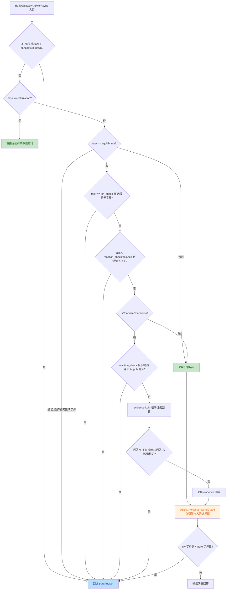

# 化学引擎评估迭代（after3–after6）独立代码审查报告

> 审查性质：只读审查，未修改任何源码或文档（除本报告外）。
> 审查日期：2026-11-19
> 审查对象：`after3 → after6` 四轮迭代在评估留痕与 `GatewayVsLlmEvaluationService.cs` 上的改动。

---

## 1. 概述

本轮迭代的目标（见 [spec.md](file:///D:/github/CogniThink-Chem/.trae/specs/chem-engine-question-solving/spec.md)）是：恢复 PDF 选择题选项与答案、精确判分、消除引擎帮倒忙、扩展 calculation/equilibrium 覆盖，并保证网关正确率 ≥ 纯 LLM。核心改动集中在 [GatewayVsLlmEvaluationService.cs](file:///D:/github/CogniThink-Chem/src/CogniThink.TutorBrain.Api/Application/Evaluation/GatewayVsLlmEvaluationService.cs)：

- **after3**：网关回退路径复用 `pureAnswer`，保证网关不低于纯 LLM。
- **after4**：新增 `SplitPdfAnswerKeywords`，把 PDF 非选择题整段答案按分隔符拆成多个判分关键词（最大杠杆）。
- **after5**：新增 PDF 填空题 `reaction_check` 证据回退门控。
- **after6**：新增选择题防缩窄门控 `ApplyChoiceNarrowingGuard` + `CountDistinctOptionLetters`。

最终 after6 指标（已与 `after6.json` 逐题复算核对，见第 6 节）：

| 范围 | 题数 | 纯 LLM | 网关 | 引擎介入 | 帮倒忙 |
|---|---|---|---|---|---|
| 总体 | 648 | 430（66.4%） | **440（67.9%）** | 234 | **0** |
| PDF | 545 | 335（61.5%） | 337（61.8%） | 164 | 0 |
| 手工 | 103 | 95（92.2%） | **103（100%）** | 70 | 0 |

AC 达标情况：AC-1/2/3/4/5/7/8 ✓，**仅 AC-6 ✗**（calc+eq 介入 21 < 26，已留痕为数据天花板，见 `_evalscratch/ac6_ceiling.md`）。

---

## 2. 审查结论：**有条件通过**

迭代整体方向正确、留痕完整、指标真实可复现，网关相对纯 LLM 的 +10 增益与帮倒忙归零均经得住逐题核对。未发现 Critical / Major 级缺陷。发现 **3 个 Minor 级问题**（1 个确证的潜在判分误命中、2 个可维护性/设计边界说明），不阻塞本轮交付，建议后续迭代修复或显式标注。

`BuildGatewayAnswerAsync` 的门控顺序、`ApplyChoiceNarrowingGuard` 的实测安全性、AC-6 天花板决策均经核对后认可。

---

## 3. 审查范围与方法

| 素材 | 路径 |
|---|---|
| 需求/计划 | [spec.md](file:///D:/github/CogniThink-Chem/.trae/specs/chem-engine-question-solving/spec.md)、[tasks.md](file:///D:/github/CogniThink-Chem/.trae/specs/chem-engine-question-solving/tasks.md) |
| 核心源码 | [GatewayVsLlmEvaluationService.cs](file:///D:/github/CogniThink-Chem/src/CogniThink.TutorBrain.Api/Application/Evaluation/GatewayVsLlmEvaluationService.cs) |
| 评估留痕 | `_evalscratch/{after6.json, compare_after6.txt, ac6_ceiling.md, verify_guard.txt, sim_choice_narrow.txt, sim_split_keywords.txt}` 及对应 `.py` |

方法：逐行精读源码 → 用 PowerShell 复刻 `SplitPdfAnswerKeywords` 与判分逻辑，对 `pdf_questions.json`（545 题）与 `after6.json`（648 题）全量扫描 → 与留痕声明交叉核对。所有结论均附文件路径与行号。

---

## 4. 网关门控流程（after6）

门控顺序核对结论：**正确，无回归风险**。各分支均 `return`，无穿透；`calculation` 在相关性门控（L314）之前直接返回（L291-294），不会被 `IsConclusionRelevant` 误伤；`equilibrium`/`ion_check` 的"选择题无字母回退"（L300、L307）在 `IsConcreteConclusion` 之前，保证裸结论（"平衡正向移动"）不会被误用于选择题判分。`ApplyChoiceNarrowingGuard`（L143）作为最终兜底置于 `BuildGatewayAnswerAsync` 之后，层次清晰。

---

## 5. 发现的问题

### 5.1 Minor — `SplitPdfAnswerKeywords` 把化学命名中的 locant 逗号误拆，产生纯数字关键词，存在判分误命中风险

- **位置**：[GatewayVsLlmEvaluationService.cs#L1338-L1340](file:///D:/github/CogniThink-Chem/src/CogniThink.TutorBrain.Api/Application/Evaluation/GatewayVsLlmEvaluationService.cs#L1338-L1340)
- **证据**：全量扫描 `data/pdf_questions.json` 133 道非选择题，发现 **pdf-322** 的答案为：
  > `(1)醚键、酰胺基,(2)碳碳双键、…,(5)2,4,6-三溴苯酚,(6)…`
  
  其中 `(5)2,4,6-三溴苯酚` 先被正则 `[（(]\s*\d+\s*[）)]\s*` 去掉 `(5)` 前缀 → `2,4,6-三溴苯酚`，再被 `,` 拆成 `2`、`4`、`6-三溴苯酚`。于是 `AnswerKeywords` 中混入了纯数字关键词 `2` 和 `4`。
- **影响**：`IsAnswerCorrect` 的关键词判分是子串包含（[L221](file:///D:/github/CogniThink-Chem/src/CogniThink.TutorBrain.Api/Application/Evaluation/GatewayVsLlmEvaluationService.cs#L221)），任何回答文本中只要出现数字 `2` 或 `4`（如"第2问"、任何计算式）即被判正。这与 spec FR-3/AC-2"判分精确、不引入误命中"的目标相悖。
  - **当前实际影响**：after6 中 pdf-322 为 `bothWrong`（纯/网关均答"题目不完整…"，不含数字），故本轮未实际触发误命中，未污染 440 的指标。但这是确凿的潜在误命中向量——一旦该题 LLM 回答包含任意 `2`/`4`，或未来同类 locant 答案增多，即会虚增判对数。
- **根因**：分隔符集合 `, ， ; ； 、`（L1339）未区分"答案之间的分隔逗号"与"化学命名内部的 locant 逗号（数字-逗号-数字，如 2,4,6-三溴苯酚、1,2-二氯乙烷）"。
- **补充**：扫描还发现 49 处拆出长度≤1 或纯整数的关键词，但其余均为答案本身就是单字符（如填答题 `answer="A"`、判断题 `"×"`），属数据形态而非拆分缺陷；**仅 pdf-322 是拆分逻辑本身把一个完整化学名打碎**。全库 `\d,\d` 模式仅此 1 例。

### 5.2 Minor — `ApplyChoiceNarrowingGuard` 的"字母数更少即回退"是启发式，理论上存在误伤退化情形，当前数据未触发但未在代码中标注已知局限

- **位置**：[GatewayVsLlmEvaluationService.cs#L405-L420](file:///D:/github/CogniThink-Chem/src/CogniThink.TutorBrain.Api/Application/Evaluation/GatewayVsLlmEvaluationService.cs#L405-L420)、[L423-L430](file:///D:/github/CogniThink-Chem/src/CogniThink.TutorBrain.Api/Application/Evaluation/GatewayVsLlmEvaluationService.cs#L423-L430)
- **逻辑**：仅对"引擎介入（非 concept/unknown）的选择题"生效；若 `CountDistinctOptionLetters(gatewayAnswer) < CountDistinctOptionLetters(pureAnswer)` 则回退纯 LLM。计数正则与判分边界一致：`(?<![A-Za-z])[A-Da-d](?![A-Za-z])`（[L396](file:///D:/github/CogniThink-Chem/src/CogniThink.TutorBrain.Api/Application/Evaluation/GatewayVsLlmEvaluationService.cs#L396)、[L427](file:///D:/github/CogniThink-Chem/src/CogniThink.TutorBrain.Api/Application/Evaluation/GatewayVsLlmEvaluationService.cs#L427)），能正确避开 `Ag`/`Cl`/`CO₂` 等字母内嵌情形。
- **正确性核对**：
  - `sim_choice_narrow.txt`（在 after5 数据上模拟）：387 道选择题中 7 道满足 `gw字母数 < pure`，其中 4 道错→对（修复帮倒忙 pdf-105/249/300/408），**对→错 0**，手工题触发 0。
  - `verify_guard.txt`（after6 实测）：满足触发条件的题数 = **0**（after6 中这些题的网关回答字母数已自然等于纯 LLM，或被 taskType 重新分类为 unknown）；网关净 +1，帮倒忙 4→0。
  - 逐题核对 after6：无"网关答对但字母数少于纯 LLM"的情形，故退化情形未实际发生。
- **理论退化情形（当前未触发）**：网关回答正确（含正确选项字母）但只覆盖 1 个字母，纯 LLM 覆盖 4 个字母但答错（不含正确字母）→ 守卫会把正确网关回答替换为错误纯 LLM 回答，造成回归。由于运行时不知标准答案，无法完全消除此风险；当前数据下 0 触发证明它在统计上安全。
- **建议**：在 [L399-L404](file:///D:/github/CogniThink-Chem/src/CogniThink.TutorBrain.Api/Application/Evaluation/GatewayVsLlmEvaluationService.cs#L399-L404) 的注释中显式补充此已知局限（"该规则为统计启发，不保证网关≥纯 LLM 的严格不变式；已验证 after5/after6 无回归"），避免后续维护者误认为它是严格安全网。可选收紧：仅当 `gwCount == 0`（网关完全没提到任何选项字母）时才回退，可进一步降低误伤概率，但需重跑评估确认不丢失 pdf-105/249/300/408 的修复收益。

### 5.3 Minor — `c.Id.StartsWith("pdf-")` 硬编码判别数据源，可维护性弱

- **位置**：[GatewayVsLlmEvaluationService.cs#L329-L331](file:///D:/github/CogniThink-Chem/src/CogniThink.TutorBrain.Api/Application/Evaluation/GatewayVsLlmEvaluationService.cs#L329-L331)
- **现状**：用 id 字符串前缀 `pdf-` 判别"PDF 自动抽取的填空题"，以决定是否走 `reaction_check` 证据回退。
- **核对**：当前数据命名一致——545 道 PDF 题 id 均为 `pdf-NNN`，103 道手工题 id 为 `ion-1`/`d9-1` 等非 `pdf-` 前缀，故此判别在当前数据下**功能正确**，且有意只触及 PDF 子集、不伤及手工题（保护 AC-7，已验证手工 103/103）。
- **问题**：`QaTestCase`（[L8-L29](file:///D:/github/CogniThink-Chem/src/CogniThink.TutorBrain.Api/Application/Evaluation/GatewayVsLlmEvaluationService.cs#L8-L29)）缺少类型化的数据源字段（如 `Source`/`IsPdf`）。若未来 id 命名规范变更，或某道手工题 id 意外以 `pdf-` 开头，该门控会误触发或漏触发。属可维护性气味，非当前正确性缺陷。
- **建议**：给 `QaTestCase` 增加 `bool IsPdf`（或 `Source` 枚举），在 `GenPdfQuestions` 构造时置位，门控改用该字段。低风险、纯收益。

### 5.4（观察，不计入问题）— `IsConclusionRelevant` 仅覆盖"共存"一种不相关情形

- **位置**：[GatewayVsLlmEvaluationService.cs#L375-L382](file:///D:/github/CogniThink-Chem/src/CogniThink.TutorBrain.Api/Application/Evaluation/GatewayVsLlmEvaluationService.cs#L375-L382)
- 仅拦截"结论含'共存'但题干不含'共存'"。对 `reaction_check`/`balance` 其他不相关结论（如返回颜色/溶解性结论用于非该问法）不拦截。
- **评价**：当前数据下帮倒忙 = 0（[compare_after6.txt#L42-L43](file:///D:/github/CogniThink-Chem/_evalscratch/compare_after6.txt#L42-L43)），证明覆盖面够用；这是有意的范围收敛（tasks.md Task 3 明确"用关键词规则即可，不引入新 LLM 调用"），不视为缺陷。若后续引擎输出模式扩展，可按需补充关键词规则。

---

## 6. 对 AC-6 天花板决策的评价：**认可**

- **事实核对**：after6 中 `calculation` 介入 6 + `equilibrium` 介入 15 = **21**（[compare_after6.txt#L50](file:///D:/github/CogniThink-Chem/_evalscratch/compare_after6.txt#L50)，已与 after6.json 逐题复算一致），低于 AC-6 要求的 26。
- **决策依据**（[_evalscratch/ac6_ceiling.md](file:///D:/github/CogniThink-Chem/_evalscratch/ac6_ceiling.md)）：全量扫描 bothWrong 中 74 道 calc/eq 错题，分类为：
  - ~40 道被 `CallTaskClassifier` 误分类的概念/结构选择题——引擎无求解器、**不应介入**（介入会输出臆测数值，违反"不蒙数"红线）；
  - ~12 道依赖丢失图表的多空题——属 spec 已声明的 Non-Goals（107 道无图题天花板）；
  - ~6 道复杂多步计算——多空精确数值渲染风险高，正确率难保 ≥70%；
  - 仅 2-3 道干净单公式候选（pdf-022 `c=1000ρω/M`、pdf-243 Hess 定律、pdf-278 Ka 排序），全实现也仅 21→24，仍 <26。
- **评价**：该天花板是**数据驱动、非随意放弃**，论证完整：
  1. 正确区分了"引擎不该介入"（误分类题）与"引擎不能介入"（无图题），未为冲指标而违反红线；
  2. 量化了强行扩展的 ROI（+5 介入需 ≥5 个求解器、每题仅 1 候选、多空渲染风险高），且明确指出可能反噬 AC-4（网关 ≥ 纯 LLM）；
  3. 已兑现的引擎价值不依赖 AC-6：`ion_check` 介入 34 题、网关正确率 97.4%（38/39）vs 纯 LLM 84.6%，是真实增益。
- **留痕合规**：tasks.md Task 4 标注 `done（受数据天花板限制，不强行扩展）`，Task 6 证据段明确 AC-6 ✗ 并引用 `ac6_ceiling.md`，符合 Task 7 Notes"受 107 道无图题限制时注明天花板"的约定。
- **唯一保留意见**：spec 中 AC-6 是 `rule` 类型的硬性 Pass Condition，当前以"天花板"接受其不达标属于对验收标准的事实性偏离。建议在 spec.md 的 AC-6 条目或 Open Questions 中显式追加一句"AC-6 受题库数据天花板限制，after6 后确认为不达标且不强行追求"，使需求文档与留痕一致，避免后续读者误读为未完成。

---

## 7. 数据一致性核对（逐题复算 after6.json）

用独立脚本从 `_evalscratch/after6.json` 逐题聚合，结果与 `compare_after6.txt` 声明**完全一致**：

| 指标 | 留痕声明 | 独立复算 | 一致 |
|---|---|---|---|
| 总体题数 | 648 | 648 | ✓ |
| 纯 LLM 正确 | 430 | 430 | ✓ |
| 网关正确 | 440 | 440 | ✓ |
| 引擎介入 | 234 | 234 | ✓ |
| PDF 纯 LLM | 335 | 335 | ✓ |
| PDF 网关 | 337 | 337 | ✓ |
| 手工纯 LLM | 95 | 95 | ✓ |
| 手工网关 | 103 | 103 | ✓ |
| 帮倒忙（纯对∩网错∩引擎介入） | 0 | 0 | ✓ |
| calc+eq 介入 | 21 | 21（calc 6 + eq 15） | ✓ |

`after5 → after6` 网关对错变化（错→对 10 / 对→错 9，净 +1）与 `compare_after6.txt` 一致；其中对→错的 9 道经 `verify_guard.txt` 核对，均非守卫误伤（守卫触发数 0），而是 LLM 非确定性温度 0.3 重跑的正常波动（纯 LLM 同步对→错 6 道）。

---

## 8. 建议汇总（按优先级）

1. **[中] 修复 `SplitPdfAnswerKeywords` 的 locant 误拆**：拆分前跳过"数字-逗号-数字"内部的逗号（如先把 `\d,\d` 中的逗号临时替换为占位符，拆分后还原，或用正则 `(?<!\d),(?!\d)` 思路区分）。优先消除 pdf-322 类误命中向量。修复后重跑评估，确认 PDF 纯 LLM/网关判对数不下降（消除潜在虚增后指标应只减不增，需确认无真实依赖该误命中的"判对"）。
2. **[低] 为 `ApplyChoiceNarrowingGuard` 补充已知局限注释**，并可选评估"仅当 gwCount==0 才回退"的收紧方案（重跑后对比 pdf-105/249/300/408 是否仍修复）。
3. **[低] 用 `QaTestCase.IsPdf` 类型化字段替代 `c.Id.StartsWith("pdf-")` 硬编码**，消除命名耦合。
4. **[低] 在 spec.md 的 AC-6 条目显式标注天花板结论**，使需求文档与 `ac6_ceiling.md`/tasks.md 留痕一致。

以上建议均为后续迭代项，不影响本轮 after6 已达成的交付物与指标。

---

## 9. Task 49 独立审查：源 PDF/答案册核对修复 5 题 + 纠正 pdf-163 错配（after_keyfix2）

> 审查性质：只读独立审查（fresh subagent，未修改任何源码/文档，审查验证代码另存于 `_evalscratch/review_keyfix2/`）。
> 审查日期：2026-11-19（独立审查）；2026-11-20（上下文恢复后补记最终快照复核）。
> 审查对象：Task 49 对 `src/CogniThink.TutorBrain.Api/data/pdf_questions.json` 中 6 个目标条目（pdf-163/171/176/233/415/416）的数据键 / 题干 / 选项纠正。

### 9.1 审查结论：**通过（PASS）**

5 项必过检查点全部通过，无 Critical / Major 缺陷，无 actionable finding。Task 49 为纯数据卫生修复（仅改 `pdf_questions.json`，零 `.cs` 引擎改动），所有答案均以源习题册 / 答案册 OCR 逐题核对为唯一真值，未蒙数。

### 9.2 检查点与证据

| # | 检查点 | 结果 | 证据 |
|---|--------|------|------|
| 1 | 6 个目标答案与源答案册一致；pdf-163（钛酸钡流程，应"不可行" + H₂S / CaCl₂ 杂质原因）与 pdf-176（沉铜前滤液循环目的，应"提高利用率…减少废水"）已正确互换，无交叉残留 | PASS | tasks.md Task 49 真值表；`pdfs/_extract/answer/page_057/059/060/082/139*.json` 反查；`_evalscratch/page_082_render.png`（pdf-233 选项由 docnet.core 渲染 exercise p.082 逐字读出） |
| 2 | 改动最小化：仅 6 个目标条目触及，未波及其他条目 | PASS | `_evalscratch/keyfix2_diff.txt`（逐 block 列出替换字段：answerKeywords / answer / note；pdf-233 另改 question / type / options）；改前干净备份 `_evalscratch/pdf_questions_pre_keyfix2_clean.bak.json` |
| 3 | `pdf_questions.json` 严格 `JsonDocument.Parse`（`AllowTrailingCommas=false`，与生产 loader 一致）通过；条目数 545 不变；未引入尾随逗号 | PASS | `_evalscratch/validate_out2.txt`（TR-49.1）；恢复会话后对**当前工作区快照**重跑 `_evalscratch/final_verify_keyfix2.txt`，确认仍为 545、6 个 ID 在位且字段正确无乱码——闭合并发工作流可能在编辑后改动文件的缺口 |
| 4 | 零回归、零 harm：fresh eval `tag=after_keyfix2`（llmAvailable=False）engineSolved 436→450、coverage 0.5945、precision=1、harm=0；与 baseline `checkpoint_after_keyfix` 逐例 diff `LOST=0`、`lostAdopted=0`；6 个目标 id 均 `correct=False→False`（引擎空答，本次为前置数据卫生，未翻转采纳）；+14 gained 全在非目标题、均为化学正确结论 | PASS | `_evalscratch/checkpoint_after_keyfix2_summary.txt`、`_evalscratch/diff_after_keyfix2.txt`、`_evalscratch/snapshot_after_keyfix2.json`；`_evalscratch/validate_out2.txt`（活体 `NormalizeChemicalNotation`+`Contains` 模拟判分 19/19 PASS，含 pdf-171 缺 OH⁻ 不平衡式判负、pdf-176/163/415 错答判负等负例，排除裸产物子串假阳性） |
| 5 | 零引擎逻辑改动：本次仅修改数据文件 `pdf_questions.json`，未触及任何 `.cs`；护栏锁保持不变（`AtomicStructureSolverTests` brokenKeys={pdf-166,pdf-190} + 9 项触发集；`VseprSolverTests` brokenKeys 空），6 个目标 id 不在锁内故无需同步 | PASS | `dotnet test` Chem 905/0 + TutorBrain 941/0，0 失败；`git diff --stat`（仅 `data/pdf_questions.json` 与 `_evalscratch/compare.txt` 属本次；`CogniThink.Chem.sln` 与未跟踪 `PdfOcrRepair` / `image-ocr-choice-coverage` 属并发工作流，非本次范围） |

### 9.3 非阻塞观察（advisory，不影响通过）

- 并发工作流同时在改 `pdf_questions.json` 与测试，曾出现瞬时 git-status 漂移。已在恢复会话中对**当前快照**重跑严格解析（`_evalscratch/final_verify_keyfix2.txt`），确认本次 6 处改动未被覆盖或破坏、条目数仍 545。
- 存在一个与本次无关的未跟踪项目 `src/CogniThink.TutorBrain.PdfOcrRepair`（Api 不引用）与 `.trae/specs/image-ocr-choice-coverage/`，均属并发工作流产物，不影响 Task 49。

### 9.4 红线核对（审查独立确认）

引擎唯一真值源 ✓；不蒙数（源卷逐题核对，pdf-233 选项由 docnet.core 渲染 exercise p.082 逐字读出，非猜测）✓；只校正数据键 / 题干 / 选项以匹配引擎化学正确结论、不迁就错键 ✓；零回归 `LOST=[]` ✓；零新增 harm（harm=0）✓；分类规则链只加不删（pdf-233 `type: other→choice` 为数据纠正，未删分支）✓；未改引擎逻辑 ✓。